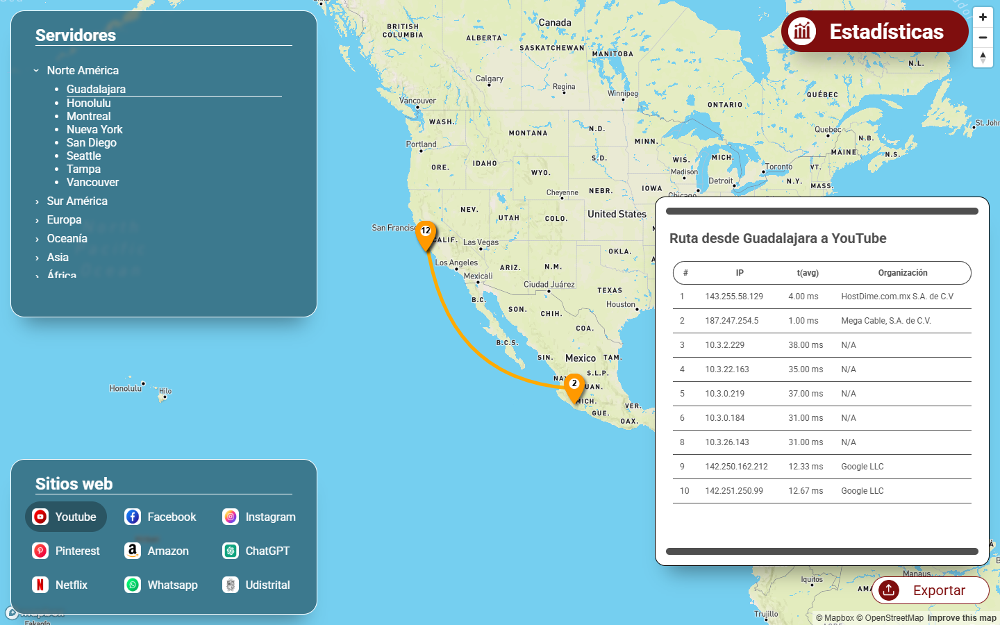
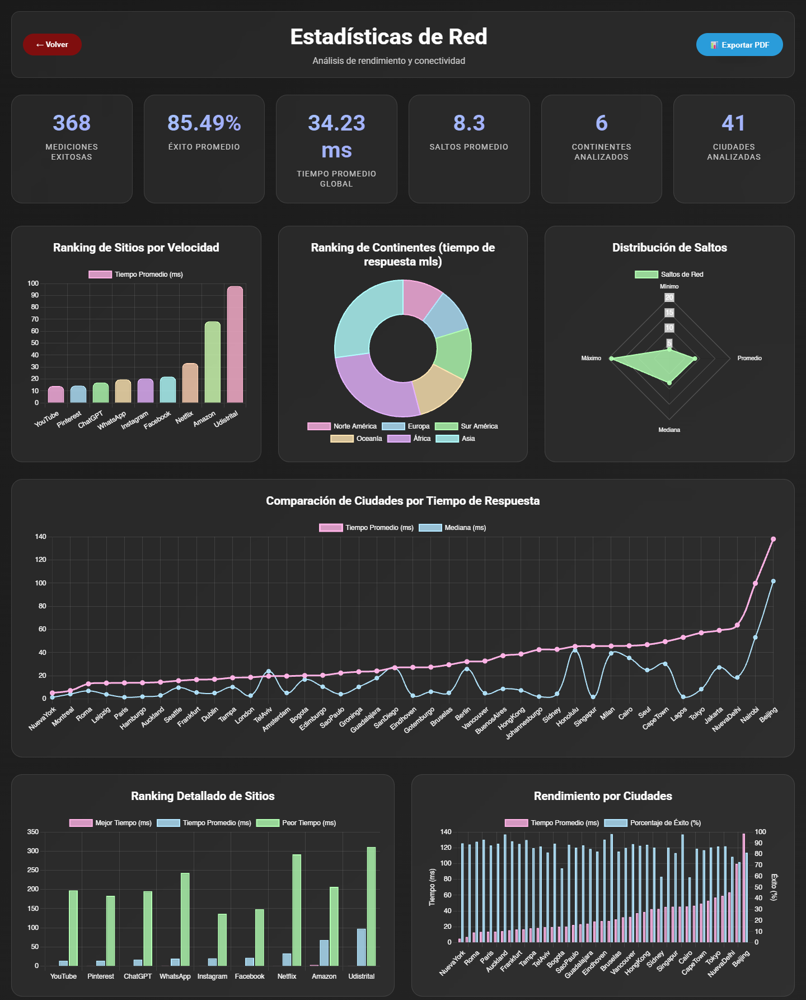

# TraceRoute 2.0 — Visualizing How Internet Traffic Travels

> 🇪🇸 Plataforma web que muestra cómo viajan los paquetes de datos desde 41 ciudades del mundo hasta 9 sitios web.

The internet looks instant, but every request crosses a chain of networks that users never see. TraceRoute 2.0 makes that path visible: it shows the routes packets take from **41 cities across 6 regions** to **9 websites** (Amazon, Facebook, ChatGPT, Instagram, Netflix, Pinterest, WhatsApp, YouTube and the Universidad Distrital site).

For each route it shows the hops, the latency per hop and the IP addresses, on an interactive map and in a statistics dashboard.



> ℹ️ The public deployment (traceroute.live) is currently offline. You can run the app locally with the steps below.

Built as a solo project for the university research group *Grupo de Investigación II* (Universidad Distrital, 2025). Its accessibility was later evaluated and improved against WCAG in the *Human Factors* course.

## Features

- 🗺️ **Interactive world map** with each route's origin, hops and destination, and animated packet flow.
- 📊 **Statistics dashboard** comparing hops, latency and success rate by city, region and destination.
- 📥 **Export:** each route to a text file, and a PDF report from the dashboard.
- 📱 **Responsive UI**, designed to work on touch devices and large touch tables.
- ♿ **Accessibility improvements**: semantic HTML, screen-reader friendly navigation and W3C validation.

## Results

From the 369 stored traces, as the dashboard reports them:

| Metric | Value |
|---|---|
| Successful measurements | 368 |
| Average success rate | 85.49 % |
| Average response time | 34.23 ms |
| Average hops | 8.3 |
| Fastest / slowest destination | YouTube 14.17 ms / Universidad Distrital 97.82 ms |
| Fastest / slowest origin city | New York 5.18 ms / Beijing 137.99 ms |



## Data

- **369 traceroute datasets** in `Backend/Datos/<region>/<REGION>_<City>_<Site>.csv`. Regions: AF, AS, EU, NA, OC, SA.
- The data was collected from public traceroute servers.
- `TraceRutes.py` and `Backend/ProcessRutes.py` parse the raw traces into `datos_procesados.json`.
- `ProcessStats.py` computes the aggregate statistics.

## Architecture

```
CSV traces ──► ProcessRutes / TraceRutes (parse) ──► datos_procesados.json
                                     │
                                     ▼
                       ProcessStats (aggregate metrics)
                                     │
             Flask API ──────────────┴───────────────► JS front end (map + charts)
   /api/<dataset>  /api/estadisticas  /api/report       main.js · routes.js · statsLogic.js
```

| Endpoint | Returns |
|---|---|
| `GET /` | Interactive route map |
| `GET /stats` | Statistics dashboard |
| `GET /api/<dataset_key>` | Processed hops for one origin–destination pair |
| `GET /api/estadisticas` | Aggregated statistics |
| `GET /api/report` | Summary report |

## Run it locally

Tested with Python 3.13 on Windows.

```bash
pip install -r requirements.txt
python App.py            # http://localhost:10000
# production: gunicorn App:app
```

## Limitations

- **Stored data, not live:** the app shows saved traces, so routes and latencies can be out of date.
- **Not a network benchmark:** each result depends on the public server that ran the trace and on when it ran.
- **No automated tests yet.**

## Roadmap

Live traceroutes on demand · historical storage to track route changes over time · automated tests

## Tech

Python · Flask · Gunicorn · pandas · JavaScript · Mapbox GL JS · Chart.js · HTML/CSS

---
Author: **Juan Diego Murillo** · [LinkedIn](https://www.linkedin.com/in/juandiegomurillo) · 2025
